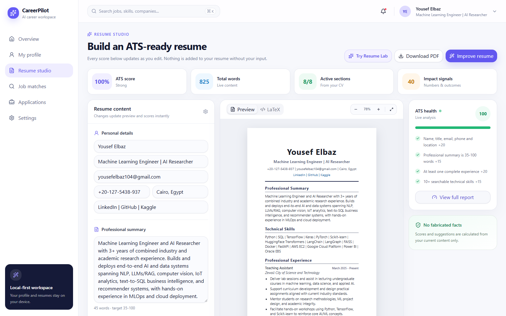
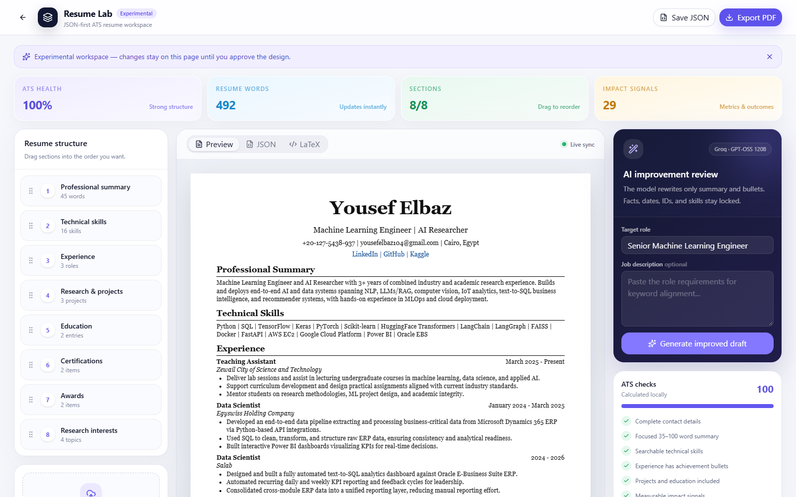
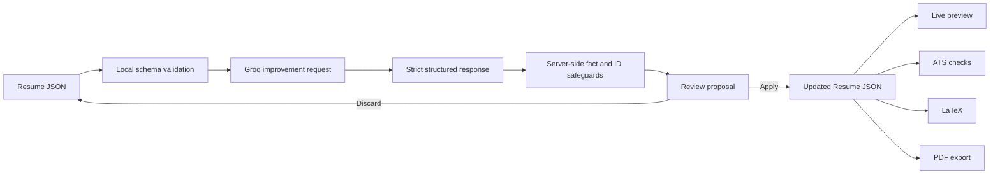

# CareerPilot Resume Studio

[](https://www.typescriptlang.org/)
[](https://react.dev/)
[](https://groq.com/)
[](#license)

CareerPilot Resume Studio is a local-first, AI-assisted resume workspace for creating structured, ATS-readable resumes. It combines a live resume editor, deterministic ATS checks, a JSON-first experimental workspace, a controlled AI improvement workflow, LaTeX generation, and direct PDF export.

The application keeps resume structure under deterministic application control. AI can improve the professional summary and achievement bullets, but it cannot replace the template, reorder fields, change dates, or silently add unsupported experience.

## Screenshots

### Resume Studio

The main workspace provides live editing, an ATS preview, real-time metrics, health checks, LaTeX access, and direct PDF export.



### Resume Lab

Resume Lab is the JSON-first experimental workspace for section reordering, AI tailoring, schema validation, and controlled draft review.



## Completed Features

### Resume Studio

- Editable personal details, professional summary, skills, experience, projects, education, certifications, awards, and research interests.
- Add and remove controls for repeatable resume sections.
- Live resume preview that updates while content is edited.
- Real-time ATS score, word count, active-section count, and impact-signal count.
- Deterministic ATS checks for contact details, summary length, technical skills, experience completeness, education, projects, and measurable impact.
- Compact LaTeX tab with one-click source copying.
- Direct PDF download without opening the browser print dialog.
- Selectable, ATS-readable PDF text using a fixed resume renderer.
- Natural page flow that avoids forced blank space before project sections.
- Responsive desktop and mobile layouts.

### Resume Lab

- Canonical resume JSON schema validated with Zod.
- Drag-and-drop JSON import with local validation before AI processing.
- Downloadable JSON snapshots for local editing and versioning.
- Drag-and-drop section reordering.
- Synchronized Preview, JSON, LaTeX, and PDF output.
- Live ATS metrics calculated directly from the current JSON document.
- Target-role input and optional job-description tailoring.
- Review-first AI workflow with explicit Apply and Discard actions.
- Clear warnings when useful metrics are missing instead of fabricating numbers.
- Motion and interaction states with reduced-motion support.

### AI Resume Improvement

- Server-side Groq integration using `openai/gpt-oss-120b` by default.
- Strict JSON Schema responses for predictable application behavior.
- AI may rewrite only the professional summary and bullet text.
- Personal details, employers, roles, dates, education, technologies, section order, and record IDs remain locked.
- Unknown metrics and unsupported claims are returned as warnings rather than inserted into the resume.
- AI output remains a proposal until the user explicitly applies it.
- API keys remain server-side and are never sent to the browser.

## How the AI Workflow Works

Typing a target role or job description does not immediately overwrite the resume. This is intentional.

1. Enter the target role.
2. Paste the job description.
3. Select **Generate improved draft**.
4. Review the proposed changes and warnings.
5. Select **Apply draft** to update the resume.
6. Preview, JSON, LaTeX, ATS checks, and PDF export update together.



## Architecture

The structured JSON document is the source of truth. LaTeX and PDF are generated outputs, not editable primary storage.

```text
Resume JSON
├── Local ATS analysis
├── Live HTML preview
├── ATS-safe LaTeX generator
├── Direct PDF renderer
└── AI improvement API
    ├── Groq structured output
    ├── Zod validation
    ├── Immutable factual fields
    └── Review-before-apply UI
```

## Technology Stack

| Area | Technology |
| --- | --- |
| Application | Vinext, React 19, TypeScript |
| Styling | Tailwind CSS, shadcn-compatible UI primitives |
| Validation | Zod |
| AI provider | Groq Chat Completions API |
| Default model | `openai/gpt-oss-120b` |
| PDF generation | pdf-lib |
| Icons | Lucide React |
| Local runtime | Node.js 22 or newer |

## Getting Started

### Prerequisites

- Node.js `22.13.0` or newer
- pnpm
- A Groq API key for AI improvement

### Installation

```bash
git clone https://github.com/yousefbaz12/careerpilot-resume-studio.git
cd careerpilot-resume-studio
pnpm install
```

Create `.env.local` in the project root:

```env
GROQ_API_KEY=your_groq_api_key
GROQ_MODEL=openai/gpt-oss-120b
```

Start the development server:

```bash
pnpm dev
```

Open the application:

- Resume Studio: `http://localhost:5173/`
- Resume Lab: `http://localhost:5173/resume-lab`

## Available Commands

| Command | Purpose |
| --- | --- |
| `pnpm dev` | Start the local development server with hot reload |
| `pnpm build` | Create a production build |
| `pnpm start` | Run the built application locally |
| `pnpm lint` | Run the ESLint checks |

## Resume JSON Model

The canonical document includes:

```text
personal
summary
skills[]
experience[]
projects[]
education[]
certifications[]
awards[]
interests[]
sectionOrder[]
```

Every experience, project, and education entry has a stable ID. The AI endpoint receives those IDs and must return them unchanged, which allows improved text to be merged safely into the original resume structure.

## ATS and Formatting Guarantees

- The PDF contains selectable text rather than a screenshot of the resume.
- Standard section headings are used for reliable parsing.
- The renderer avoids browser headers, footers, and print-dialog artifacts.
- Section order is controlled by validated JSON.
- The PDF renderer uses natural page breaks instead of forcing projects onto a new page.
- AI output cannot modify the LaTeX template or PDF layout.
- LaTeX special characters are escaped before rendering.

## Privacy and Security

- Resume editing, ATS checks, JSON validation, LaTeX generation, and PDF generation run locally.
- Resume content is sent to Groq only when **Generate improved draft** is selected.
- `GROQ_API_KEY` is read only by the server route.
- `.env*` files are excluded from Git.
- Never commit `.env.local` or paste API keys into issues, pull requests, or screenshots.

## Project Structure

```text
app/
├── api/improve-resume/route.ts   Groq integration and safeguards
├── resume-lab/page.tsx           JSON-first experimental workspace
├── page.tsx                      Main Resume Studio
└── globals.css                   Shared theme and motion
lib/
├── export-resume-pdf.ts          Direct ATS-readable PDF renderer
├── resume-latex.ts               Fixed ATS-safe LaTeX generator
└── resume-schema.ts              Canonical Zod schema and sample data
docs/screenshots/                 README product screenshots
output/pdf/                       Verified example PDF output
```

## Verification

The current implementation has been verified with:

- A successful production build.
- A direct Groq request using a Quantum Machine Learning Researcher job description.
- A structured response that changed the summary while preserving section order, experience IDs, and project IDs.
- PDF rendering and visual inspection.
- Text extraction confirming ATS-readable output.

## License

No open-source license has been selected yet. All rights are reserved until a license file is added.

